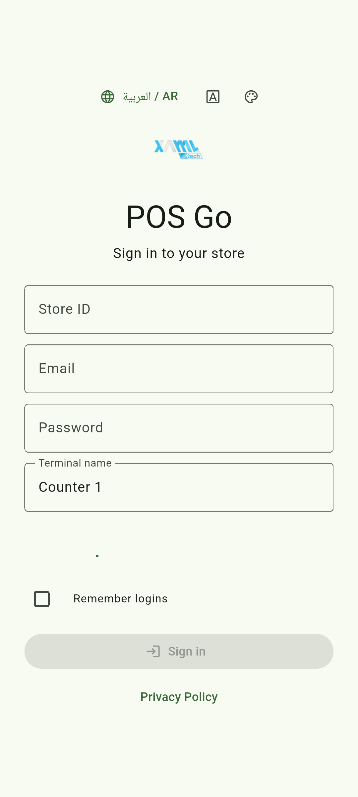
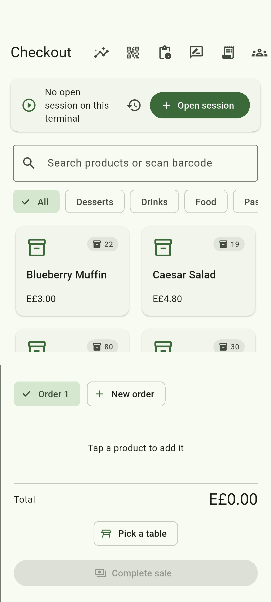
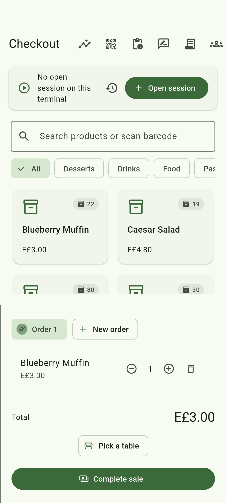
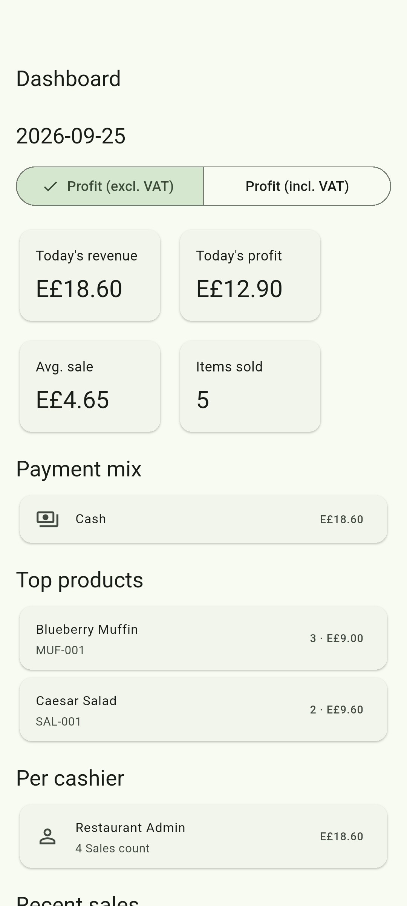
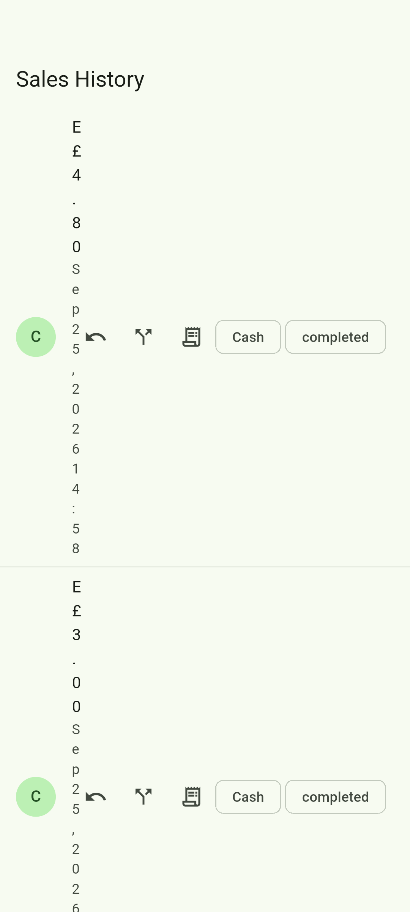
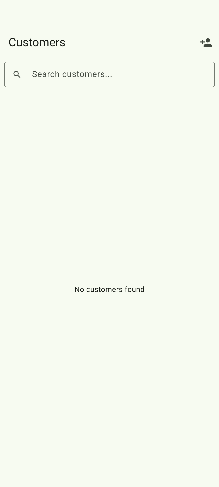
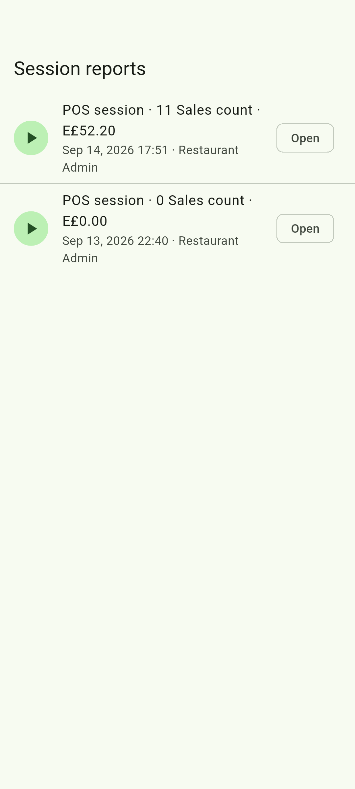
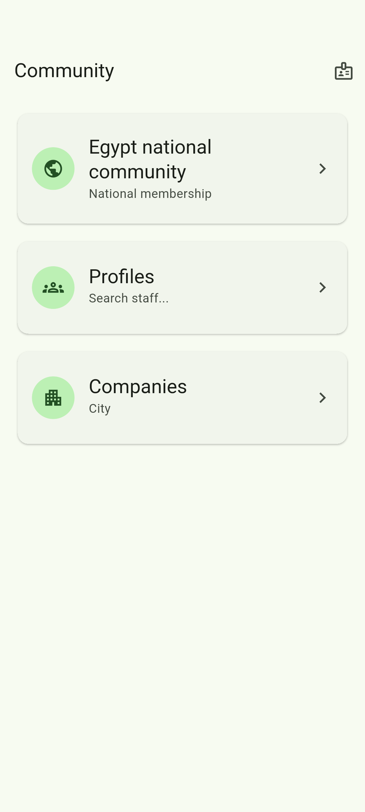
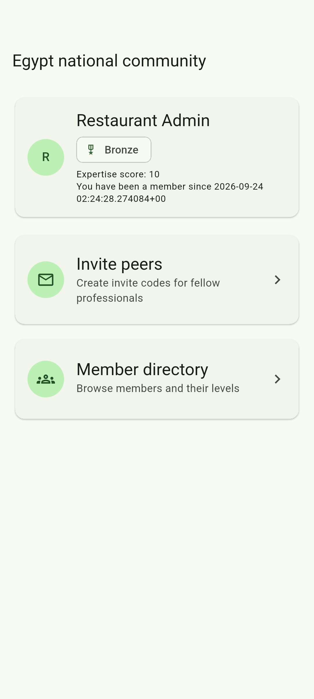

# POS.Go

**Offline-first point of sale for Egyptian shops, cafés and restaurants.**

Arabic-first, EGP-native, built to keep selling when the network does not.

| | |
|---|---|
| Google Play | <https://play.google.com/store/apps/details?id=com.xamltech.pos_go> |
| Package | `com.xamltech.pos_go` |
| Current release | 1.0.0 (versionCode 3) |
| Product site | <https://posgo.xamltech.com> |
| Privacy policy | <https://posgo.xamltech.com/private> |
| Delete your data | <https://posgo.xamltech.com/delete-account> |
| The studio | <https://xamltech.com> |
| Support | support@xamltech.com |

## What this repository is

**Documentation only.** It holds the release notes, the version history, the
technical roadmap and product information for POS.Go.

It deliberately contains **no source code**. The application source (a Go/Gin
backend and a Flutter Android client) is maintained privately; if you want to
report a bug or request a feature, use the channels above.

| Document | What it covers |
|---|---|
| [`CHANGELOG.md`](CHANGELOG.md) | Every shipped version, newest first, with user-facing notes |
| [`ROADMAP.md`](ROADMAP.md) | What is being built next and why |
| [`VERSIONING.md`](VERSIONING.md) | Version numbering, `versionCode` policy, and what counts as a breaking change |
| [`docs/TECHNOLOGY.md`](docs/TECHNOLOGY.md) | How it works: Go backend, Flutter client, offline sync, invoice OCR, database, SaaS controls, security model |
| [`docs/screenshots/`](docs/screenshots/) | The screens below, as captured on a device |
| [`LICENSE`](LICENSE) | Proprietary — XAMLtech. All rights reserved |

## Screens

Real screens, captured on a device against a live backend. All of them are
reachable from the sign-in screen — nothing here needs a seeded account.

| | | |
|---|---|---|
|  |  |  |
| **Sign-in** — store ID, email, password, and *Create store* for a free trial | **Product grid** — categories, search, barcode scanning and stock badges on every tile | **Cart** — quantity steppers, net total, and the payment sheet with split tender and discount policy |
|  |  |  |
| **Dashboard** — today's revenue, average sale and items sold, payment mix, top products, per-cashier split | **Sales history** — paginated, with a receipt preview and one-tap refunds | **Customers** — records with phone, email and loyalty points earned per sale |
|  |  |  |
| **Cash sessions** — one per terminal, with the Z-report showing expected versus counted | **POS Copilot** — staff profiles and the companies they work for | **Egypt-wide directory** — member levels, expertise scores and moderation |

Arabic and English ship in the same build, with a right-to-left layout; these
are the English screens.

## What POS.Go does

**Checkout**

- Product grid with categories, search, barcode scanning and live stock badges
- Split payments across cash, card and mobile money
- Discounts under a configurable policy: off, warn, hard cap, or manager approval by PIN
- Tips, VAT, cash rounding and a printed balance line
- Restaurant mode: assign a table, add a tip, split the bill per cover
- Focus mode for a distraction-free cashier screen

**Cash till**

- One cash session per terminal: opening float, counted closing cash, and a
  Z-report showing expected versus counted
- Session history per device for end-of-day reconciliation

**Stock and suppliers**

- Stock on hand per product, with low-stock warnings and an out-of-stock block
- Manual adjustments for damaged goods, restock and stock counts
- Invoice scanning: photograph a supplier invoice, review the lines detected,
  apply in one tap — stock and cost update, unknown items can be created on the spot
- Purchases history with supplier and invoice numbers

**Reports**

- Today: revenue, profit with and without VAT, average sale, items sold
- Payment mix, top products, per-cashier breakdown
- Sales history with receipt preview and one-tap refunds that restock

**Receipts and printers**

- Thermal printer pairing over Wi-Fi or by IP, 80 mm and 58 mm paper
- Receipt preview on the device, plus paper size, copies, cut and theme settings

**Customers and loyalty**

- Customer records with phone, email and loyalty points earned on every sale

**Self-order and QR menu**

- Publish a QR menu for tables or the counter: customers scan, order and request
  items; staff approve from the same device

**Offline first**

- Catalog cached on the device, sales queued when the network drops and replayed
  automatically on reconnect
- Device-to-device sync, so a second till sees the same catalog and stock

**Language and roles**

- Full Arabic and English interface with right-to-left layout
- Per-user roles (owner, manager, cashier) and per-user access levels
- Manager PIN for refunds, discounts over the cap and closing the cash drawer

**Built for Egypt**

- EGP and Egyptian phone formats out of the box
- Create your own store in the app and start on a free 15-day trial, no card needed
- VAT-aware profit reporting and an Egyptian community for staff and shop owners

## Getting started

The sign-in screen, the sign-up flow and the privacy pages are public — no
account is needed to look around. To try the full product, tap **Create store**
on the sign-in screen with any email address and password. The trial store is
provisioned instantly, already stocked with a demo catalog, and includes every
feature for 15 days.

## About XAMLtech

POS.Go is built by **XAMLtech**, an Egyptian software studio in Cairo, working
since 2024.

> Software that keeps Egyptian businesses moving.

We build the tools a real shop actually runs on — a point of sale that keeps
selling through an outage, the platform that operates it, and the community
around it. Three things, designed as one system instead of three vendors. Built
here, in Arabic and English, priced in pounds.

The studio site is <https://xamltech.com>. The product site is
<https://posgo.xamltech.com>, and the platform console for operators is at
<https://api.xamltech.com/admin/>.

**How we work.** Three rules we do not bend, because they are the ones a counter
feels:

- **It has to work during an outage.** A till that stops selling when the network
  is unreliable is not a till. Offline is the default case, not an edge case.
- **The server decides anything that costs money.** Discounts, refunds, stock and
  prices are evaluated where the data is, so a modified app gets the same answer
  as an honest one.
- **The person at the counter is the user.** One-handed, fast, and forgiving of a
  dropped connection. Depth belongs in the product; complexity does not belong in
  the middle of a queue.

**This repository** is documentation for the released product: what shipped, what
version it is, what is being built next, and how the system works underneath. The
source is private by choice — the reasoning behind a decision is often more
useful to us internally than a permissively-licensed copy would be to a shop that
just wants a till.

## Support

- Email support@xamltech.com
- Self-service: create a store, or read the privacy policy and the
  account-deletion page at the links above

Licensing of the application itself is not stated in this repository; see the
Google Play listing for the terms that apply to the distributed app.

## Licence

This repository and the POS.Go product are the exclusive property of XAMLtech.
All rights reserved — see [`LICENSE`](LICENSE). No part of it may be copied,
redistributed, mirrored, or used to build a dataset or train a model without
written permission.
